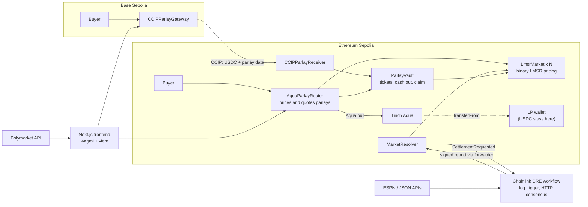

# Parlay Markets

**The first parlay on 1inch Aqua.** Pick several sports or prediction-market outcomes, combine them into one ticket, and get paid only if every leg wins. Pricing, liquidity and settlement all happen on-chain.

> ETHGlobal Mumbai 2026 hackathon project. This is a **testnet prototype (Sepolia and Base Sepolia). It is not audited.**

---

## Contents

1. [Introduction](#introduction)
2. [The problem](#the-problem)
3. [The solution](#the-solution)
4. [How it works](#how-it-works)
5. [Architecture](#architecture)
6. [Sponsor technology](#sponsor-technology)
7. [Deployments](#deployments)
8. [Running it locally](#running-it-locally)
9. [Repository layout](#repository-layout)

---

## Introduction

A parlay is one bet made of several legs. Every leg must win, so the payout is larger than betting each leg alone. Parlays are the most popular bet type at sportsbooks, but they have never had a good on-chain home.

Parlay Markets makes a parlay a single on-chain ticket:

- Each leg is a binary market priced by an automated market maker (LMSR).
- The ticket price is the product of the leg prices plus a 10% house margin.
- Liquidity providers (LPs) back payouts with USDC that stays in their own wallets until a ticket is actually sold.
- A Chainlink CRE workflow reads the real-world result and settles each market.
- A buyer on another chain can buy a ticket through Chainlink CCIP.

## The problem

1. **Parlays are opaque and one-sided.** Sportsbooks set the odds, take the margin, and can limit or close accounts that win. Users cannot see how a parlay price is built.
2. **On-chain parlays are capital-hungry.** A naive design makes LPs deposit a large payout reserve into a pool up front. That money sits idle, and the reserve has to cover the worst case, because one ticket can pay many times its stake.
3. **Settlement needs trusted data.** Someone has to say who won. A single operator reporting results is a point of failure.
4. **Liquidity and users are split across chains.** A user holding USDC on one network has to bridge by hand before they can bet.

## The solution

| Problem | What Parlay Markets does |
|---|---|
| Opaque pricing | Every leg is an on-chain LMSR market. The parlay price is `Π(leg prices) × 1.1`, computed by the contract and quotable before you buy. |
| Idle capital | LPs use **1inch Aqua** virtual liquidity. They `ship` a USDC reserve that **stays in their wallet**. Aqua `pull`s from it only when a ticket is bought. |
| Trusted settlement | A **Chainlink CRE** workflow fetches the result with multi-node consensus and writes a signed report to the `MarketResolver` contract. |
| Cross-chain friction | A **Chainlink CCIP** gateway on Base Sepolia sends real Circle USDC plus the parlay data to Sepolia, where the ticket is minted. |

Example: two legs priced 0.50 each give `0.50 × 0.50 × 1.10 = 0.275`. A $10 stake pays `10 / 0.275 = $36.36` if both legs win.

## How it works

**For liquidity providers (once per set of markets)**

1. Seed each `LmsrMarket` with `ship(amount, b)`, where `b` is the LMSR liquidity parameter.
2. Approve USDC to the Aqua contract.
3. Call `lpShipAqua(markets, payoutReserve)` on the router. Aqua records the virtual balance. The USDC does not move.

**For buyers (every parlay)**

1. Pick up to five legs on the Markets page. Market data comes from Polymarket's public API.
2. The router reads each leg's LMSR price, applies the 10% margin and quotes the payout.
3. `buyParlay(...)` pulls the stake from the buyer, calls `Aqua.pull` to bring in the payout from the LP's wallet, and mints a ticket in `ParlayVault`.
4. The buyer can cash out early at the current market value, or hold the ticket.

**Settlement**

1. Anyone calls `MarketResolver.requestSettlement(matchId, market)`. It emits `SettlementRequested`.
2. The CRE workflow's EVM log trigger fires.
3. Each node fetches the result (ESPN for football, or a configured JSON API for other markets such as a price threshold). The nodes reach consensus on it.
4. The workflow signs a report and writes it to the resolver through the CRE forwarder. The resolver calls `LmsrMarket.resolve`.
5. If every leg won, the ticket owner calls `claim`.

**Cross-chain purchase**

1. On Base Sepolia the user calls `CCIPParlayGateway.sendParlay(markets, outcomes, stake, minPayout)` and pays the CCIP fee in ETH.
2. CCIP carries Circle USDC and the parlay data to Sepolia.
3. `CCIPParlayReceiver` receives the message and mints the ticket in `ParlayVault`.

## Architecture



### Components

| Component | Path | Role |
|---|---|---|
| `LmsrMarket` | `contracts/src/LmsrMarket.sol` | One binary market per event. Holds LMSR state, buys and sells units, and is resolved by the resolver. |
| `AquaParlayRouter` | `contracts/src/AquaParlayRouter.sol` | Quotes and sells parlays. Calls `Aqua.ship`, `Aqua.dock` and `Aqua.pull`. |
| `ParlayVault` | `contracts/src/ParlayVault.sol` | Holds tickets and stake. Handles `cashOut` and `claim`. |
| `MarketResolver` | `contracts/src/MarketResolver.sol` | Emits settlement requests and accepts CRE reports (`onReport` / `receiveReport`). |
| `CCIPParlayGateway` | `contracts/src/CCIPParlayGateway.sol` | Base Sepolia entry point for cross-chain buys. |
| `CCIPParlayReceiver` | `contracts/src/CCIPParlayReceiver.sol` | Sepolia CCIP receiver that mints the ticket. |
| CRE workflow | `cre/market-resolver/` | TypeScript workflow: log trigger, consensus HTTP fetch, report write. |
| CRE monitor | `cre/monitor.mjs` | Finds unresolved markets past kickoff, requests settlement, and runs the CRE workflow in **local simulation** (`cre workflow simulate`). Its status is shown on the LP page. |
| Frontend | `frontend/` | Next.js 15 app: landing, `/markets`, `/parlay`, `/tickets`, `/lp`, and the `/pitch` deck. |
| Showreel | `video/` | Remotion project that renders the demo motion graphic. |

### Pricing

Each market is a binary LMSR market. With outstanding units `q0` and `q1` and liquidity parameter `b`, the price of outcome `i` is `exp(qi/b) / (exp(q0/b) + exp(q1/b))`. The parlay price multiplies the chosen leg prices and then applies the margin:

```
parlayPrice = Π priceᵢ × 1.10
payout      = stake / parlayPrice
```

## Sponsor technology

### 1inch Aqua: virtual liquidity

- **Where:** `AquaParlayRouter.lpShipAqua` (`Aqua.ship`), `lpDockAqua` (`Aqua.dock`) and `buyParlay` (`Aqua.pull`).
- **Why it fits:** a parlay pool has to cover large, correlated payouts. With Aqua the LP commits a reserve without moving it, so the same USDC can back many tickets and keeps earning elsewhere until a ticket is bought.
- **Strategy:** the hash of the market list gates which parlays a given LP covers.
- Aqua on Sepolia: `0x1111113CCf1426A8E30e2bfF5E005d929bF6a90a`.

### Chainlink CRE: settlement

- **Where:** `cre/market-resolver/workflow.ts`.
- **Flow:** `EVMClient.logTrigger` on `SettlementRequested`, then `HTTPClient.sendRequest` with node consensus (median on scores, or the configured source for value markets), then `runtime.report` and `evmClient.writeReport` to the resolver.
- **Why it fits:** no operator decides the winner. Results come from several nodes and arrive through the CRE forwarder.
- Simulate: `cre workflow simulate market-resolver --target staging-settings --broadcast`, or run `cre/simulate.sh`.

### Chainlink CCIP: cross-chain buys

- **Where:** `CCIPParlayGateway.sendParlay` (`ccipSend`) and `CCIPParlayReceiver._ccipReceive`.
- **Flow:** programmable token transfer. Circle USDC on Base Sepolia is bridged to Circle USDC on Sepolia together with the leg data. The fee is paid in native ETH.
- **Chain selectors:** Ethereum Sepolia `16015286601757825753`, Base Sepolia `10344971235874465080`.

### Polymarket API

Market questions and prices on the Markets page come from Polymarket's public API. Price history is proxied through `frontend/app/api/pricehistory`.

## Deployments

All contracts are on testnets. Addresses are read from `NEXT_PUBLIC_*` environment variables in the frontend, so a running deployment may point at a newer redeploy than the tables below. `frontend/lib/contracts.ts` holds the defaults.

### Ethereum Sepolia (chain ID 11155111)

| Contract | Address | Source |
|---|---|---|
| AquaParlayRouter | `0x3617455115c85ab2bdb67c2dc8720d1d8afc0f76` | `/pitch` page |
| ParlayVault | `0x8d98ff91515b47f8a2b89d00cb597497dc47fbe0` | `/pitch` page, CCIP deploy script |
| MarketResolver | `0x5d5cc1cd24943ecf43ad5e88281393418ca06bea` | `/pitch` page |
| MarketResolver (CRE staging config) | `0x79AcDa877B38570d4A2e7Ee84dC5AA60E6AeE934` | `cre/market-resolver/config.staging.json` |
| AquaParlayRouter (frontend default) | `0xE4EeF51383a53aFFd8d2C6661FfFcCF6578EAb0c` | `frontend/lib/contracts.ts` |
| 1inch Aqua | `0x1111113CCf1426A8E30e2bfF5E005d929bF6a90a` | `frontend/lib/contracts.ts` |
| Chainlink CRE forwarder | `0xf8344cfd5c43616a4366c34e3eee75af79a74482` | `frontend/lib/contracts.ts` |
| CCIP router | `0x0BF3dE8c5D3e8A2B34D2BEeB17ABfCeBaf363A59` | `DeployCCIPReceiver.s.sol` |
| Circle USDC | `0x1c7D4B196Cb0C7B01d743Fbc6116a902379C7238` | `frontend/lib/contracts.ts` |

### Base Sepolia (chain ID 84532)

| Contract | Address | Source |
|---|---|---|
| CCIPParlayGateway | `0x99045AC039c7828C4597C3463944EFCE4b2f7611` | `frontend/lib/contracts.ts` |
| CCIP router | `0xD3b06cEbF099CE7DA4AcCf578aaebFDBd6e88a93` | `DeployCCIPGateway.s.sol` |
| Circle USDC | `0x036CbD53842c5426634e7929541eC2318f3dCF7e` | `frontend/lib/contracts.ts` |

### Deploying

```bash
# Core contracts (Sepolia)
cd contracts
forge script script/DeployFull.s.sol --rpc-url $SEPOLIA_RPC --broadcast

# Demo markets, and the Aqua router
forge script script/DeployDemoMarkets.s.sol --rpc-url $SEPOLIA_RPC --broadcast
forge script script/DeployAqua.s.sol        --rpc-url $SEPOLIA_RPC --broadcast

# CCIP: receiver on Sepolia, gateway on Base Sepolia, then wire them together
PRIVATE_KEY=... BASE_SEPOLIA_RPC=... ./script/deploy-ccip.sh
```

Read the scripts before broadcasting: some constants (vault and market addresses) are hard-coded to a previous deployment and need updating for a fresh one.

The frontend deploys as a standard Next.js app (for example on Vercel). Set the `NEXT_PUBLIC_*` variables listed below in the host's environment settings.

## Running it locally

### Frontend

```bash
cd frontend
npm install
npm run dev        # http://localhost:3000
```

Create `frontend/.env.local` with the contract addresses (never commit it). The variables the app reads:

`NEXT_PUBLIC_PARLAY_ROUTER`, `NEXT_PUBLIC_PARLAY_VAULT`, `NEXT_PUBLIC_MARKET_RESOLVER`, `NEXT_PUBLIC_MOCK_USDC`, `NEXT_PUBLIC_MARKETS` (comma-separated), `NEXT_PUBLIC_AQUA_ROUTER`, `NEXT_PUBLIC_STRATEGY_HASH`, `NEXT_PUBLIC_CCIP_GATEWAY`, `NEXT_PUBLIC_BASE_USDC`, `NEXT_PUBLIC_DEPLOYER`.

Connect an injected wallet (such as MetaMask) on Sepolia. You need test USDC for the buy and LP flows.

### Contracts

```bash
cd contracts
git submodule update --init --recursive
forge build
forge test
```

The Aqua fork tests need `MAINNET_RPC_URL` set.

### CRE workflow

```bash
cd cre
export PRIVATE_KEY=...        # a throwaway testnet key
./simulate.sh
# or
cre workflow simulate market-resolver --target staging-settings --broadcast
```

### Showreel video

```bash
cd video
npm install
node scripts/score.mjs        # generates public/score.wav
npx remotion studio src/index.ts
npx remotion render src/index.ts ParlayMarkets out/parlay-markets-showreel.mp4
```

## Repository layout

```
contracts/    Solidity (Foundry): markets, router, vault, resolver, CCIP, deploy scripts, tests
cre/          Chainlink CRE workflow, monitor and simulation script
frontend/     Next.js 15 + wagmi/viem app
video/        Remotion showreel and video assembly scripts
```

`parlay markets.md` is the original design spec. It is **historical**: the shipped design is simpler (the router calls `Aqua.pull` directly, and `LmsrMarket` is a standalone contract).
