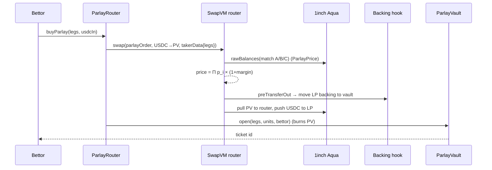

# Parlay Markets: the first parlay on 1inch Aqua

> **🥇 The first parlay on 1inch Aqua.**

**On-chain parlays and live cash-out on 1inch Aqua, priced by a new SwapVM instruction where Aqua strategies price each other.**

Built at **ETHGlobal Mumbai 2026** for:

| Sponsor | Prize track | What it powers |
|---|---|---|
| **1inch** | Build an Aqua App | Core: LP wallet liquidity (Aqua) + parlay / cash-out pricing (SwapVM) |
| **Chainlink** | Best workflow with CRE | Match results fetched from sports APIs and written on-chain |
| **Arkiv** | Build on Arkiv (from scratch) | Market catalog, LP desks and shareable parlay slips that expire at kickoff |

---

## Table of contents

1. [The problem](#1-the-problem)
2. [The solution](#2-the-solution)
3. [What is new (vs. past 1inch Aqua winners)](#3-what-is-new)
4. [Architecture](#4-architecture)
5. [Pricing math](#5-pricing-math)
6. [How each sponsor technology is used](#6-how-each-sponsor-technology-is-used)
7. [Smart contracts](#7-smart-contracts)
8. [SwapVM programs](#8-swapvm-programs)
9. [Chainlink CRE workflow](#9-chainlink-cre-workflow)
10. [Arkiv data model](#10-arkiv-data-model)
11. [Repository structure](#11-repository-structure)
12. [Getting started](#12-getting-started)
13. [Build phases](#13-build-phases)
14. [Testing](#14-testing)
15. [Demo script](#15-demo-script)
16. [Security and safety rules](#16-security-and-safety-rules)
17. [Sponsor requirement checklist](#17-sponsor-requirement-checklist)
18. [Limitations and future work](#18-limitations-and-future-work)
19. [References](#19-references)

---

## 1. The problem

A **parlay** is one ticket made of several bets ("legs"). It pays out only if **every** leg wins:

> CSK beats MI **and** RCB beats KKR **and** GT beats RR → pay $23.10, win $100.

**Parlays are the biggest product in betting.**
- Parlays made up **63% of New Jersey's online sports betting revenue** through October 2025 ([TS2](https://ts2.tech/?p=20708509)).
- On Kalshi, parlays went from **under 3% of volume (Sept 2025) to ~22% (April 2026)** ([Sports Illustrated](https://www.si.com/betting/prediction-market/kalshi/who-is-really-winning-on-kalshi-parlays-according-to-the-data)).
- Kalshi's "Combos" did **$100M+ in one week** ([TS2](https://ts2.tech/?p=20708509)).

**But today's parlays have structural weaknesses:**

| Platform | How parlays work | Weakness |
|---|---|---|
| **Polymarket** | Beta (US), priced by market makers through request-for-quote ([InGame](https://www.ingame.com/?p=52884)) | Pricing comes from market-maker quotes, not an open on-chain formula; still beta |
| **Kalshi** | Regulated, centralized exchange, quoted by market makers | Off-chain, not open |
| **Overtime (Thales)** | On-chain Parlay AMM, LPs deposit into a pool | LP money is deposited and locked; full potential payout is locked from the pool; analysts called it "very capital inefficient, particularly for long shot bets" ([Delphi](https://members.delphidigital.io/feed/thales-update-diving-deeper-into-parlays-march-madness-and-implications-of-tip-99), [Thales governance](https://gl.app/dao/thalesgov.eth/proposals/0x8bd576e1b96c1d5a7082d04149176376e20a9c498aa805e8bcfe5bccc7bc5324)) |
| Other on-chain parlays (ParlayMarket, PredictShark, SX Bet) | Oracle-priced, per-combination LP pools, or peer-to-peer matching | Liquidity is pooled or fragmented per combination |

**The gap:** there is no on-chain parlay system where
1. the **liquidity provider's money stays in their own wallet** until a bet is placed,
2. the **price is calculated automatically from live on-chain market prices**, and
3. **one wallet backs single bets, parlays and cash-outs**, with a hard cap on risk.

---

## 2. The solution

**Parlay Markets** builds parlays on **1inch Aqua + SwapVM**:

1. **Every match is an Aqua strategy.** Team prices come from an LMSR pricing instruction, so they always sum to 100%.
2. **A new SwapVM instruction, `ParlayPrice`,** reads the **live balances of the match strategies** inside Aqua, converts them to probabilities, multiplies the legs, adds the LP margin, and prices the parlay **instantly**.
3. **The LP's money never leaves their wallet** until a bet happens. A SwapVM hook pulls only the LP's share of that bet into `ParlayVault`, so every payout is fully backed.
4. **Live cash-out:** the same instruction prices a ticket in reverse, so a holder can sell a parlay back early at a live price.
5. **Chainlink CRE** fetches match results from multiple sports APIs and writes them on-chain to settle every market and parlay.
6. **Arkiv** stores markets, LP desks and shareable parlay slips as wallet-owned data that expires automatically at kickoff.

**Example**

| Leg | Market | Live price |
|---|---|---|
| 1 | CSK beats MI | 0.60 |
| 2 | RCB beats KKR | 0.50 |
| 3 | GT beats RR | 0.70 |

Fair price = 0.60 × 0.50 × 0.70 = **0.21** → with 10% margin = **0.231**.
Ravi pays **$23.10** for **100** units of payout. The LP backs **$76.90** from their wallet. The vault holds **$100**.
All legs win → Ravi gets $100. Any leg loses → the LP gets $100 back immediately.

---

## 3. What is new

Past 1inch "Build an Aqua App" winners and what they did:

| Winner | Idea |
|---|---|
| Aqua Outcome Market (1st, Buenos Aires) | pm-AMM binary prediction markets, JIT outcome minting, yield on idle capital |
| OddsFlow (1st, Tokyo) | Fixed-price limit orders on many Seer markets from one wallet |
| Solvent (1st, ETHOnline) | Solvency-aware opcodes for over-committed books |
| ArcBook (1st, Lisbon) | Order book of bounded pricing curves |
| ColdCascade (2nd, ETHOnline) | Extruction reading Hyperliquid's order book inside the trade |
| Superposition (3rd, ETHOnline) | Yield-bearing Aqua capital, new opcodes |
| KSwap-VM (3rd, Lisbon) | Formal verification of SwapVM |
| Watermark (3rd, Tokyo) | DAO treasury desk with ENS-gated counterparties |
| Agora Markets (Continuity 2nd) | Futarchy with Aqua lots |

**What no one has done, and what Parlay Markets adds:**

1. **Cross-strategy pricing.** Every past instruction reads either its *own* balances or an *external* source (oracle / order book). `ParlayPrice` prices a trade in one strategy by reading **other Aqua strategies**. Aqua strategies become live price sources for each other: no oracle, no stale price.
2. **The first multi-leg product on Aqua.** Past prediction-market winners sell single outcomes only.
3. **Live cash-out** priced by the same SwapVM instruction.
4. **Pay-per-bet LP model.** No upfront pool deposit; LP backing is pulled per bet at bet time, capped by the shipped amount, and released when any leg loses.

> We reuse proven patterns (JIT minting, guards) for the legs and credit the projects that pioneered them. The novelty is the parlay layer on top.

---

## 4. Architecture

```
            ┌──────────────────────────────┐
            │      FRONTEND (Next.js)      │
            │ legs · price · cash out · LP │
            └───────┬───────────────┬──────┘
   browse / slips   │               │ buy parlay / cash out
                    ▼               ▼
        ┌──────────────┐   ┌───────────────────┐
        │    ARKIV     │   │   ParlayRouter    │  only allowed taker
        │ markets,     │   │ prices + opens    │  (one atomic tx)
        │ desks, slips │   └─────────┬─────────┘
        └──────────────┘             ▼
                     ┌───────────────────────────────┐
                     │ SwapVM (forked AquaSwapVMRouter)
                     │  Deadline · OnlyOpenMarket     │
                     │  LmsrSwap · ParlayPrice · Salt │──┐ reads live
                     └──────┬────────────────────────┘  │ leg balances
                            │ pull / push               ▼
┌──────────────┐    ┌──────────────────────────────────────────┐
│  LP WALLET   │◄──►│             1inch AQUA (official)        │
│ money stays  │    │ Match A: CSK vs MI     (LMSR strategy)    │
│ here         │    │ Match B: RCB vs KKR    (LMSR strategy)    │
└──────────────┘    │ Match C: GT vs RR      (LMSR strategy)    │
                    │ Parlay P: [USDC, PV]   (payout cap)        │
                    └──────────────────────────────────────────┘
                            │ preTransferOut hook moves LP backing
                            ▼
                  ┌───────────────────┐     ┌────────────────────┐
                  │   ParlayVault     │◄────│ CategoricalMarket  │
                  │ tickets, escrow,  │     │ outcome tokens,    │
                  │ settle, cash-out  │     │ resolve(winner)    │
                  └───────────────────┘     └─────────▲──────────┘
                                                      │ onReport
                                            ┌─────────┴──────────┐
                                            │  Chainlink CRE     │
                                            │ sports APIs → DON  │
                                            │ consensus → write  │
                                            └────────────────────┘
```



### Life of a parlay

1. **Bettor picks legs** in the UI (optionally copies a slip from Arkiv).
2. `ParlayRouter.buyParlay(legs, amount)` calls `swap()` on the forked SwapVM router, passing the legs in the taker instruction args.
3. The parlay strategy program runs: `Deadline` → `ParlayPrice` (+ guards) → `Salt`.
4. `ParlayPrice` reads each leg's live LMSR price from its **match strategy in Aqua**, multiplies, adds margin, and fills the swap registers.
5. The **maker hook** (`preTransferOut`) moves the LP's share of the backing into `ParlayVault`.
6. Aqua settles: bettor's USDC → LP wallet, PV → router.
7. In the same transaction, `ParlayRouter` calls `ParlayVault.open(...)`, which burns PV and records the ticket.
8. **Chainlink CRE** resolves each match on `CategoricalMarket`.
9. `ParlayVault.settle(ticket)`: all legs won → bettor claims; any leg lost → LP claims immediately.

---

## 5. Pricing math

### 5.1 Leg markets: LMSR (Logarithmic Market Scoring Rule)

For a market with outcomes *j = 1..N* and liquidity parameter *b*:

```
q_i = − balance_i                                  (fewer tokens left = more bought)
p_i = e^(q_i / b) / Σ_j e^(q_j / b)                (prices always sum to 1)
C(q) = b · ln( Σ_j e^(q_j / b) )                   (cost function)
cost of a trade = C(after) − C(before)
LP max loss = b · ln(N)
```

Closed forms used in `LmsrSwap`:

```
Buy, exact-out (receive Δ of outcome i):   X = b · ln(1 + p_i · (e^(Δ/b) − 1))
Buy, exact-in  (pay X):                    Δ = b · ln(1 + (e^(X/b) − 1) / p_i)
Sell Δ of outcome i:                       X = −b · ln(1 + p_i · (e^(−Δ/b) − 1))
```

Numerics: subtract `max(q)` before exponentiating; use fixed-point `expWad` / `lnWad` (e.g. Solady `FixedPointMathLib`); round in the maker's favor.

### 5.2 Parlay price

```
P_fair  = Π_k p_k              (legs from different, independent matches)
P       = P_fair · (1 + m)     (m = LP margin, e.g. 0.10)
trader pays   = n · P
LP backs      = n · (1 − P)
vault holds   = n              (payout per unit = 1 USDC)
```

### 5.3 Cash-out price

For a ticket with *n* units, where some legs already won (p = 1) and others are live:

```
V_fair = n · Π_{live legs} p_k
V      = V_fair · (1 − m_cashout)
```

If any leg already lost, cash-out value is 0 and the LP can settle immediately.

---

## 6. How each sponsor technology is used

### 1inch Aqua
Aqua is a shared liquidity layer: makers approve tokens to Aqua instead of depositing into pools, and Aqua tracks **virtual balances per strategy** (`ship`, `dock`, `pull`, `push`, `rawBalances`, `safeBalances`).

**Used for:**
- One LP wallet ships **N match strategies + 1 parlay strategy**; tokens stay in the wallet.
- The parlay strategy's **shipped PV amount is the LP's hard cap on total parlay payouts**.
- `rawBalances(maker, router, strategyHash, token)` is read by `ParlayPrice` to get **live leg state**.

Official deployments (same address on every supported chain, see [deployments.md](https://github.com/1inch/aqua/blob/main/deployments.md)):

| Contract | Address |
|---|---|
| Aqua (registry) | `0x1111113ccf1426a8e30e2bff5e005d929bf6a90a` |
| SwapVM router (official) | `0x111111338c5091e8440b67b168bae16a668ac0de` |

> We use the **official Aqua** contract and **redeploy a modified SwapVM router** with our instructions, which the track rules allow.

### 1inch SwapVM
SwapVM runs a per-order **program** of instructions `[opcode][argsLength][args]` over a context (`query`, `swap` registers, `vm`). In Aqua mode, `orderHash = keccak256(abi.encode(order))` is the Aqua strategy hash and balances come from Aqua.

**Used for:**
- **`LmsrSwap`**: prices match markets (all outcomes sum to 100%).
- **`ParlayPrice`**: prices parlays and cash-outs by reading other strategies.
- **`OnlyOpenMarket`**: rejects trades after resolution.
- Stock **`Deadline`** and **`Salt`**.
- **Maker hooks** (`preTransferOut`) for just-in-time backing and outcome minting.
- **Taker instruction args** (read via `ctx.tryChopTakerArgs()`) carry the parlay legs into `ParlayPrice`.

### Chainlink CRE
CRE workflows (TypeScript or Go, compiled to WASM) run on a trigger (cron, HTTP, EVM log), call external APIs from every DON node, reach consensus, and write a **signed report** through the `KeystoneForwarder` to a consumer contract implementing `IReceiver.onReport(metadata, report)`.

**Used for:** fetching match results from multiple sports APIs and calling `CategoricalMarket` resolution through a `ReceiverTemplate`-based consumer.

### Arkiv
Arkiv is an Ethereum-aligned DB-chain: entities with typed attributes (max 32), **wallet ownership**, **expiration in blocks** (2s blocks on Rabdi), SQL-like queries via `@arkiv-network/sdk` (built on viem).

**Used for:** markets, LP desks and shareable parlay slips that **expire at kickoff**, read by the UI.

---

## 7. Smart contracts

| Contract | Responsibility |
|---|---|
| `CategoricalMarket.sol` | N outcome ERC-20s per match. `mintSet(amount)` (1 USDC → 1 of each outcome), `mergeSet`, `resolve(winner)` (only the CRE consumer), `redeem`. |
| `MarketResolver.sol` | Chainlink CRE consumer (`ReceiverTemplate`). `_onReport` decodes `(marketId, winnerIndex)` and calls `CategoricalMarket.resolve`. Rejects replays and unknown markets. |
| `LmsrSwap.sol` (instruction library) | Reads all outcome balances of the current strategy from Aqua, computes LMSR prices, fills `amountIn`/`amountOut` for exact-in and exact-out. |
| `ParlayPrice.sol` (instruction library) | Reads legs from taker args, validates them, reads each leg's match strategy balances from Aqua, computes `P`, enforces the payout cap, fills registers. Handles buy (USDC→PV) and cash-out (PV→USDC). |
| `OnlyOpenMarket.sol` (instruction library) | Reverts if any referenced market is resolved or past kickoff. |
| `ParlayMarketsOpcodes.sol` | Official `AquaOpcodes` dispatch **plus** our instructions in free slots. Official opcode numbers stay unchanged. |
| `ParlayMarketsRouter.sol` | Fork of `AquaSwapVMRouter` using `ParlayMarketsOpcodes`. Ownership renounced after deploy. |
| `PVToken.sol` | Parlay voucher ERC-20. `1 PV = 1 USDC of payout`. Mint/burn only by `ParlayVault`. Exists only inside one transaction. |
| `BackingHook.sol` | `IMakerHooks.preTransferOut`: for the parlay strategy, moves LP USDC into `ParlayVault` and mints PV; for match strategies, mints outcome sets just in time. Only callable by the router. |
| `ParlayVault.sol` | Holds the full payout per ticket. `open`, `settle`, `claim`, `cashOut`. Releases funds to the LP as soon as any leg loses. |
| `ParlayRouter.sol` | Only allowed taker for the parlay strategy. Calls `swap` and `ParlayVault.open` with the **same legs** in one transaction. |

### Key functions (sketch)

```solidity
// ParlayRouter
function buyParlay(Leg[] calldata legs, uint256 usdcIn, uint256 minUnits) external returns (uint256 ticketId);
function cashOut(uint256 ticketId, uint256 minUsdcOut) external returns (uint256 usdcOut);

// ParlayVault
function open(Leg[] calldata legs, uint256 units, address bettor, address lp) external returns (uint256 ticketId);
function settle(uint256 ticketId) external;             // anyone; pays the side that won
function claim(uint256 ticketId) external;

struct Leg { address market; uint8 outcome; bytes32 strategyHash; }
```

### Reading another strategy inside an instruction (core idea)

```solidity
// inside ParlayPrice: for each leg k
(uint248 bal, ) = AQUA.rawBalances(ctx.query.maker, address(this), leg.strategyHash, outcomeToken);
// convert all outcome balances of that match → LMSR p_k
```

`ctx.query.maker` keeps the read scoped to **the same LP's** strategies, so a third party cannot inject a fake leg market.

---

## 8. SwapVM programs

Instruction format: `[opcode: 1 byte][argsLength: 1 byte][args]` (max 255 bytes of args per instruction, so store long lists in contracts and pass keys).

**Match strategy** (one per match, Aqua-shipped tokens `[USDC, OUT_1..OUT_N]`):

```
Deadline(kickoff) → OnlyOpenMarket(market) → LmsrSwap(market, b) → Salt(salt)
```

**Parlay strategy** (Aqua-shipped tokens `[USDC, PV]`, PV amount = payout cap):

```
Deadline(earliestAllowed) → ParlayPrice(registry, marginBps, maxLegs) → Salt(salt)
```

**Order traits:** `useAquaInsteadOfSignature = true`, `hasPreTransferOutHook = true`, `preTransferOutTarget = BackingHook`.

**Rules from the SwapVM docs that we follow:**
- Instruction order is security-critical; fee instructions wrap the program and must come **before** pricing.
- Always include `Salt`: Aqua refuses to ship the same strategy hash twice.
- Use the same `takerData` for `quote` and `swap`.
- Check opcode numbers against the router's opcode table in a test (they are table positions in deployed v1.0.x routers; banked enum values on `main`).

> **Version note.** The deployed v1.0.x router uses `swap(order, tokenIn, tokenOut, amount, takerData)`; `main` uses `swap(order, amount, takerTraitsAndData)`. Pin one version (we recommend matching the official Aqua deployment's release) and confirm with the 1inch team at the booth.

---

## 9. Chainlink CRE workflow

**Flow:** cron trigger (or HTTP trigger after the match) → HTTP fetch from 2+ sports APIs on every node → consensus on `(marketId, winnerIndex)` → `runtime.report(...)` → EVM write to `MarketResolver` via `KeystoneForwarder`.

```
cre-workflow/
├── project.yaml
├── secrets.yaml            # API keys (never committed)
└── resolve-matches/
    ├── main.ts             # trigger + handler
    ├── config.json         # schedule, chainSelectorName, resolverAddress, gasLimit
    └── package.json
```

**Consumer contract**

```solidity
import {ReceiverTemplate} from "@chainlink/cre-contracts/ReceiverTemplate.sol";

contract MarketResolver is ReceiverTemplate {
    ICategoricalMarketRegistry public immutable registry;
    mapping(bytes32 => bool) public resolved;

    constructor(address forwarder, ICategoricalMarketRegistry r) ReceiverTemplate(forwarder) { registry = r; }

    function _onReport(bytes calldata, bytes calldata payload) internal override {
        (bytes32 marketId, uint8 winner) = abi.decode(payload, (bytes32, uint8));
        require(!resolved[marketId], "already resolved");
        resolved[marketId] = true;
        registry.resolve(marketId, winner);
    }
}
```

**Run**

```bash
npm install -g @chainlink/cre-cli        # see CRE docs for the current install method
cre init                                  # or start from cre-templates
cd resolve-matches && bun install && cd ..
cre workflow simulate resolve-matches     # simulation is enough for the prize
```

Use `MockKeystoneForwarder` for local simulation and the network's `KeystoneForwarder` when deploying.

> ⚠️ Confirm at the Chainlink booth whether the CRE prize also needs CCIP (the CCIP section says core prizes require it).

---

## 10. Arkiv data model

**Network:** Rabdi testnet · chain ID `7794095` · RPC `https://rpc.rabdi.db-chain.testnet.arkiv.network` · WS `wss://rpc.rabdi.db-chain.testnet.arkiv.network` · faucet `https://hub.arkiv.network/faucet` · access keys `https://hub.arkiv.network/access-keys`.

> Some older Arkiv pages mention the "Kaolin" testnet; use **Rabdi**.

```ts
import { addr, dec, defineSchema, i32, key, str, u64 } from "@arkiv-network/sdk/schema"

// Owner: backend wallet · Expires: kickoff + 3 days
export const Markets = defineSchema("parlaymarkets.markets", {
  league:   str().indexed(),
  teamA:    str().indexed(),
  teamB:    str().indexed(),
  kickoff:  u64().indexed(),
  status:   str().indexed(),        // "open" | "resolved"
  winner:   str().optional(),
  strategy: str(),                  // Aqua strategy hash
  market:   str(),                  // CategoricalMarket address
})

// Owner: LP wallet · Expires: 30 days, extended while active
export const Desks = defineSchema("parlaymarkets.desks", {
  lp:        addr().indexed(),
  maxPayout: dec().indexed(),
  margin:    dec(),
  markets:   str(),
})

// Owner: bettor · Expires: at the first leg's kickoff
export const Slips = defineSchema("parlaymarkets.slips", {
  creator:      addr().indexed(),
  firstKickoff: u64().indexed(),
  legCount:     i32().indexed(),
  quotedPrice:  dec().indexed(),
  copiedFrom:   key().optional(),   // set when copied from another slip
  legs:         str(),              // "marketKey:outcome,..."
})

// Owner: oracle relayer wallet (writes ONLY Chainlink-verified results) · Expires: 30 days
export const Results = defineSchema("parlaymarkets.results", {
  marketId:     str().indexed(),
  league:       str().indexed(),
  winner:       str().indexed(),
  resolvedAt:   u64().indexed(),
  sources:      i32(),               // number of sports APIs that agreed in CRE
  chainId:      u64(),
  resolveTx:    str(),               // on-chain tx where MarketResolver accepted the CRE report
  resolverAddr: str(),               // MarketResolver contract (CRE consumer)
})
```

### Trusted data: the oracle writes the results

Arkiv is public, so anyone can write an entity claiming "CSK won". Our rule: **match data on Arkiv must come from the oracle path, not from a person.**

```
Sports APIs ──► Chainlink CRE (DON consensus) ──► MarketResolver (on-chain, verified report)
                                                         │ Resolved(marketId, winner) event
                                                         ▼
                                     Oracle relayer wallet ──► Arkiv: parlaymarkets.results
                                     (only writes after the on-chain event; includes resolveTx)
```

- **Results** entities are written only by a dedicated **oracle relayer wallet**, and only after `MarketResolver` has accepted a Chainlink-signed report on-chain.
- Each result stores `resolveTx` and `resolverAddr`, so **anyone can verify** it against the chain.
- The app reads results with `.ownedBy(ORACLE_RELAYER)` and ignores any other writer.
- Market `status` / `winner` are patched by the same relayer after the event.
- Stretch: ask the Chainlink and Arkiv teams whether a CRE workflow can write to Arkiv's JSON-RPC directly (HTTP capability), which would remove the relayer.

**Writes**

```ts
await walletClient.createEntity(Slips, { ... }, {
  expiration: ExpirationTime.fromSeconds(firstKickoff - nowSeconds),
})
```

**Reads (user-facing)**

```ts
// Open IPL markets from our trusted backend wallet, soonest first
publicClient.select({ $key: true, teamA: true, teamB: true, kickoff: true })
  .from(Markets).where(and(eq("league", "IPL"), eq("status", "open")))
  .ownedBy(BACKEND_WALLET).orderBy(asc("kickoff")).limit(50).fetch()

// Verified results (only from the oracle relayer)
publicClient.select({ marketId: true, winner: true, resolveTx: true })
  .from(Results).where(eq("league", "IPL"))
  .ownedBy(ORACLE_RELAYER).orderBy(desc("resolvedAt")).limit(20).fetch()

// Copies of a slip (popularity)
publicClient.select({ $key: true }).from(Slips).where(eq("copiedFrom", key(slipKey))).fetch()
```

**Design rules from the Arkiv docs**
- Arkiv is public: use unique schema names and **trust markets only from our backend wallet**.
- Only the owner can change an entity, so a "copy" creates a **new slip owned by the copier** with `copiedFrom`.
- After CRE resolves a match on-chain, the **oracle relayer** listens for the event, writes a `results` entity with the resolving tx hash, and `patchEntity`s the market (`status`, `winner`).

**Required files:** `/arkiv/schema.md`, `/arkiv/friction.md`, `/arkiv/reach.md`, `/arkiv/why-arkiv.md`, `/arkiv/how-you-use-arkiv.md`, plus the writer wallet address(es) and one runnable query in this README.

---

## 11. Repository structure

```
parlay-markets/
├── contracts/                     # Foundry (or Hardhat) project
│   ├── src/
│   │   ├── market/CategoricalMarket.sol
│   │   ├── market/MarketResolver.sol        # CRE consumer
│   │   ├── instructions/LmsrSwap.sol
│   │   ├── instructions/ParlayPrice.sol
│   │   ├── instructions/OnlyOpenMarket.sol
│   │   ├── opcodes/ParlayMarketsOpcodes.sol
│   │   ├── router/ParlayMarketsRouter.sol
│   │   ├── parlay/PVToken.sol
│   │   ├── parlay/ParlayVault.sol
│   │   ├── parlay/ParlayRouter.sol
│   │   ├── hooks/BackingHook.sol
│   │   └── libs/LmsrMath.sol
│   ├── script/                    # Deploy, ShipMarkets, ShipParlay, BuyParlay, CashOut, Settle
│   └── test/                      # unit, fuzz, invariants, fork
├── cre-workflow/                  # Chainlink CRE project
├── app/                           # Next.js + wagmi + viem + Arkiv SDK
│   ├── lib/arkiv.ts
│   ├── lib/aqua.ts
│   └── app/(routes)
├── arkiv/                         # Arkiv judging files
│   ├── schema.md  friction.md  reach.md  why-arkiv.md  how-you-use-arkiv.md
├── docs/
│   └── requirements-map.md        # every sponsor rule → file / test / tx hash
└── README.md
```

---

## 12. Getting started

### Prerequisites
- Node.js ≥ 22.10 (Arkiv SDK) or Bun
- Foundry (`forge`, `anvil`) or Hardhat 3 (the 1inch repos build with Hardhat; Foundry works via npm packages + remappings)
- A Base (or other supported chain) RPC URL for forking
- Arkiv access key + tGLM from the faucet
- CRE CLI

### Environment

```bash
cp .env.example .env
```

```bash
# chain / fork
FORK_RPC_URL=https://base-mainnet.example/rpc
AQUA=0x1111113ccf1426a8e30e2bff5e005d929bf6a90a
USDC=<usdc on the forked chain>
PRIVATE_KEY_LP=0x...
PRIVATE_KEY_BETTOR=0x...

# arkiv
ARKIV_ACCESS_KEY=...
ARKIV_PRIVATE_KEY=0x...

# chainlink cre
SPORTS_API_KEY_1=...
SPORTS_API_KEY_2=...
```

### Contracts

```bash
cd contracts
npm install @1inch/swap-vm @1inch/aqua      # or git submodules pinned to a release tag
forge build
anvil --fork-url $FORK_RPC_URL               # local fork with the official Aqua
forge script script/Deploy.s.sol --rpc-url http://127.0.0.1:8545 --broadcast
forge script script/ShipMarkets.s.sol --rpc-url http://127.0.0.1:8545 --broadcast
forge script script/ShipParlay.s.sol  --rpc-url http://127.0.0.1:8545 --broadcast
forge script script/BuyParlay.s.sol   --rpc-url http://127.0.0.1:8545 --broadcast
```

### App

```bash
cd app && npm install @arkiv-network/sdk viem wagmi && npm run dev
```

### CRE

```bash
cd cre-workflow && cre workflow simulate resolve-matches
```

---

## 13. Build phases

The build is split into **9 phases**. Each phase has a goal, tasks, the files it touches, a "done when" check, and the commits to push. **Commit at the end of every task**: the 1inch track rejects single-commit histories.

**Overview**

| Phase | Name | Hours | Sponsor | Blocking? |
|---|---|---|---|---|
| 0 | Setup and decisions | 0–2 | All | Yes |
| 1 | Outcome markets | 2–5 | 1inch | Yes |
| 2 | LMSR match strategies | 5–11 | 1inch | Yes |
| 3 | Parlay pricing (`ParlayPrice`) | 11–17 | 1inch ⭐ | Yes |
| 4 | Vault, router and settlement | 17–22 | 1inch | Yes |
| 5 | Cash-out and hardening | 22–25 | 1inch | Partly |
| 6 | Chainlink CRE results | 25–29 | Chainlink | For settlement |
| 7 | Arkiv data layer | 29–32 | Arkiv | No |
| 8 | Frontend | 26–33 (parallel) | All | For demo |
| 9 | Demo, docs and submission | 33–36 | All | Yes |

**Priority if time runs short:** Phases 0–4 (1inch core) → 6 (Chainlink) → 7 (Arkiv) → 5 (cash-out). Binary legs are an acceptable fallback for LMSR.

---

### Phase 0: Setup and decisions (0–2 h)

**Goal:** a working fork environment pointing at the official Aqua, with versions pinned.

**Tasks**
1. Create the repo with `contracts/`, `cre-workflow/`, `app/`, `arkiv/`, `docs/`. Add a license (MIT) and `.env.example`.
2. Ask the 1inch booth which SwapVM release matches the official Aqua deployment; pin `@1inch/swap-vm` and `@1inch/aqua` to that version.
3. Start `anvil --fork-url $FORK_RPC_URL` on a supported chain (e.g. Base) and verify Aqua at `0x1111113ccf1426a8e30e2bff5e005d929bf6a90a` responds.
4. Write `script/Smoke.s.sol`: ship a stock `XYCSwap` Aqua strategy and swap once through a locally deployed `AquaSwapVMRouter`.
5. Ask the Chainlink booth whether the CRE prize also needs CCIP.

**Files:** `foundry.toml` (or `hardhat.config.ts`), `remappings.txt`, `.env.example`, `script/Smoke.s.sol`.

**Done when:** the smoke script ships a strategy and completes a swap with real token transfers on the fork.

**Commits:** `chore: scaffold repo`, `chore: pin swap-vm and aqua`, `test: smoke swap on fork`.

**Risks:** version mismatch between SwapVM `main` and the deployed release (different `swap()` signatures). Resolve here, before writing instructions.

---

### Phase 1: Outcome markets (2–5 h)

**Goal:** on-chain markets with one ERC-20 per outcome, fully collateralized.

**Tasks**
1. `OutcomeToken.sol`: minimal ERC-20, mint/burn only by its market.
2. `CategoricalMarket.sol`: `mintSet(amount)` (1 USDC → 1 of each outcome), `mergeSet(amount)`, `resolve(winner)` restricted to the resolver, `redeem(amount)`, `isOpen()`, `kickoff`.
3. `MarketFactory.sol` (or registry): create markets and map `marketId → market`.
4. Unit tests: mint/merge round-trip, only the resolver can resolve, winners redeem 1:1, losers get 0.

**Files:** `src/market/OutcomeToken.sol`, `src/market/CategoricalMarket.sol`, `src/market/MarketFactory.sol`, `test/Market.t.sol`.

**Done when:** a 2-outcome and a 6-outcome market pass all tests.

**Commits:** `feat: outcome token`, `feat: categorical market`, `test: market lifecycle`.

---

### Phase 2: LMSR match strategies (5–11 h)

**Goal:** each match trades through SwapVM with LMSR prices that always sum to 100%.

**Tasks**
1. `LmsrMath.sol`: `prices(q[], b)`, `costExactOut`, `amountExactIn`, `proceedsSell`, with max-subtraction and fixed-point `exp`/`ln` (e.g. Solady). Rounding favors the maker.
2. `LmsrSwap.sol` instruction: read all outcome balances of the current strategy via `AQUA.rawBalances(maker, address(this), orderHash, token)`, set `q_i = −balance_i`, fill `amountIn`/`amountOut` for exact-in and exact-out.
3. `OnlyOpenMarket.sol` instruction: revert if the market is resolved or past kickoff.
4. `ParlayMarketsOpcodes.sol`: copy the official Aqua dispatch and add the new instructions in free slots; official opcodes unchanged.
5. `ParlayMarketsRouter.sol`: the forked router using `ParlayMarketsOpcodes`.
6. `BackingHook.sol` (match mode): `preTransferOut` mints an outcome set from LP USDC if the LP lacks the outcome token.
7. `script/ShipMarkets.s.sol`: LP approves Aqua and ships 3 match strategies with `[USDC, OUT_1..OUT_N]`; the shipped amounts set the starting odds.

**Files:** `src/libs/LmsrMath.sol`, `src/instructions/LmsrSwap.sol`, `src/instructions/OnlyOpenMarket.sol`, `src/opcodes/ParlayMarketsOpcodes.sol`, `src/router/ParlayMarketsRouter.sol`, `src/hooks/BackingHook.sol`, `script/ShipMarkets.s.sol`, `test/LmsrMath.t.sol`, `test/LmsrSwap.t.sol`, `test/OpcodeTable.t.sol`.

**Done when**
- Fuzz test: prices sum to 1e18 within rounding for random balances.
- Buying CSK raises CSK and lowers every other outcome.
- Exact-in and exact-out agree within rounding; quote equals swap.
- The opcode-table test confirms official opcodes are unchanged.

**Commits:** `feat: lmsr math`, `feat: LmsrSwap instruction`, `feat: OnlyOpenMarket`, `feat: forked aqua router`, `feat: JIT outcome minting hook`, `script: ship match strategies`, `test: lmsr fuzz + invariants`.

**Fallback:** if LMSR numerics take too long, ship binary markets with a simple constant-product curve and keep moving to Phase 3.

---

### Phase 3: Parlay pricing, `ParlayPrice` ⭐ (11–17 h)

**Goal:** the core novelty: a SwapVM instruction that prices a parlay by reading other Aqua strategies.

**Tasks**
1. `PVToken.sol`: ERC-20, `1 PV = 1 USDC of payout`; mint/burn only by `ParlayVault`.
2. `ParlayRegistry` (or a vault view): maps `marketId → (market, strategyHash, outcome tokens)` for the LP's match strategies.
3. `ParlayPrice.sol` instruction:
   - Read legs from taker instruction args (`ctx.tryChopTakerArgs()` on `main`; check the equivalent in your pinned version).
   - Validate: taker is `ParlayRouter`, 1 ≤ legs ≤ 5, one leg per market, all markets open.
   - For each leg: read that match strategy's balances via `rawBalances(ctx.query.maker, address(this), strategyHash, token)` and compute `p_k` with `LmsrMath`.
   - `P = Π p_k × (1 + margin)`; fill registers for USDC → PV (buy).
   - Revert if `amountOut > balanceOut` (PV cap reached).
4. `script/ShipParlay.s.sol`: ship the parlay strategy with `[USDC, PV]`, where the PV amount is the LP's payout cap.

**Files:** `src/parlay/PVToken.sol`, `src/parlay/ParlayRegistry.sol`, `src/instructions/ParlayPrice.sol`, `script/ShipParlay.s.sol`, `test/ParlayPrice.t.sol`.

**Done when**
- A quote equals `Π p × (1 + m)` for 1–5 legs (fuzzed).
- Trading a single match changes the next parlay quote (linked prices).
- Invalid legs (same market twice, closed market, > 5 legs, wrong taker) revert.

**Commits:** `feat: PV token`, `feat: parlay registry`, `feat: ParlayPrice cross-strategy pricing`, `script: ship parlay strategy`, `test: parlay pricing + guards`.

---

### Phase 4: Vault, router and settlement (17–22 h)

**Goal:** a complete, fully backed parlay lifecycle with real token transfers.

**Tasks**
1. `ParlayVault.sol`: `open(legs, units, bettor, lp)`, `settle(ticketId)`, `claim(ticketId)`; holds exactly `units` USDC per ticket; releases to the LP as soon as any leg loses.
2. `BackingHook.sol` (parlay mode): on `preTransferOut` of PV, move `units × (1 − P)` USDC from the LP to the vault and mint PV to the LP for the pull.
3. `ParlayRouter.sol`: `buyParlay(legs, usdcIn, minUnits)` calls `swap` then `ParlayVault.open(...)` with the same legs in one transaction; enforces slippage.
4. `script/BuyParlay.s.sol` and `script/Settle.s.sol`.
5. Fork test: ship → buy → resolve → settle → claim, with balance assertions.

**Files:** `src/parlay/ParlayVault.sol`, `src/parlay/ParlayRouter.sol`, `src/hooks/BackingHook.sol`, `script/BuyParlay.s.sol`, `script/Settle.s.sol`, `test/Fork.t.sol`, `test/Vault.invariant.t.sol`.

**Done when**
- Invariant: vault USDC ≥ sum of open ticket units, always.
- Bettor wins → receives `units`; any leg loses → LP receives `units` immediately.
- Transaction hashes of real transfers on the fork are recorded for the demo.

**Commits:** `feat: parlay vault`, `feat: backing hook parlay mode`, `feat: parlay router atomic open`, `script: buy + settle`, `test: fork end-to-end`, `test: vault solvency invariant`.

---

### Phase 5: Cash-out and hardening (22–25 h)

**Goal:** live cash-out plus the safety rules.

**Tasks**
1. Extend `ParlayPrice` for PV → USDC (cash-out): won legs count as 1, live legs use `p_k`, apply the cash-out margin.
2. `ParlayRouter.cashOut(ticketId, minUsdcOut)`: burns the ticket into PV, swaps PV → USDC against the LP, and the vault releases the ticket's backing to the LP.
3. Run the 1inch `CoreInvariants` suite on both programs (symmetry, quote/swap consistency, monotonicity, maker-favoring rounding).
4. Renounce router ownership in the deploy script.

**Files:** `src/instructions/ParlayPrice.sol`, `src/parlay/ParlayRouter.sol`, `test/CashOut.t.sol`, `test/CoreInvariants.t.sol`, `script/Deploy.s.sol`.

**Done when:** a round trip (buy then immediate cash-out) never profits the taker, and cash-out after two legs won pays about `units × p_last × (1 − m)`.

**Commits:** `feat: cash-out pricing`, `feat: router cashOut`, `test: core invariants`, `chore: renounce router owner`.

---

### Phase 6: Chainlink CRE results (25–29 h)

**Goal:** match results from multiple sports APIs resolve markets on-chain.

**Tasks**
1. `MarketResolver.sol` extending `ReceiverTemplate`: `_onReport` decodes `(marketId, winnerIndex)`, blocks replays, calls `resolve`. Set it as the only resolver in `CategoricalMarket`.
2. Scaffold the CRE project (`cre init` or a template from `cre-templates`).
3. `main.ts`: cron (or HTTP) trigger → fetch results from 2+ sports APIs → agree on the winner → `runtime.report(...)` → write to `MarketResolver`.
4. Store API keys as CRE secrets; never commit them.
5. Run `cre workflow simulate` against the fork (use `MockKeystoneForwarder` locally).
6. Backend listener: on the `Resolved` event, patch the Arkiv market entity (Phase 7).

**Files:** `contracts/src/market/MarketResolver.sol`, `cre-workflow/project.yaml`, `cre-workflow/resolve-matches/main.ts`, `cre-workflow/resolve-matches/config.json`, `test/MarketResolver.t.sol`.

**Done when:** a simulated workflow run resolves a market, and a parlay with that leg settles correctly.

**Commits:** `feat: CRE consumer MarketResolver`, `feat: CRE resolve-matches workflow`, `test: resolver replay protection`, `docs: CRE simulation output`.

---

### Phase 7: Arkiv data layer (29–32 h)

**Goal:** open, wallet-owned markets, desks and slips that the UI reads.

**Tasks**
1. Get an access key and tGLM; configure the Rabdi chain in `app/lib/arkiv.ts`.
2. Define the `parlaymarkets.markets`, `parlaymarkets.desks`, `parlaymarkets.slips` and `parlaymarkets.results` schemas.
3. Backend script: create a market entity per shipped match (owned by the backend wallet, expires kickoff + 3 days).
4. LP flow: create or extend a desk entity when shipping the parlay strategy.
5. Bettor flow: "Share slip" creates a slip entity expiring at the first kickoff; "Copy slip" creates a new slip with `copiedFrom`.
6. Reads: market browser (filter by league, status; owned by the backend wallet), "Top slips today" (count of `copiedFrom`), LP directory.
7. Oracle relayer: listen for `MarketResolver.Resolved`, then write a `results` entity (with `resolveTx`, `resolverAddr`, `sources`) and patch the market's `status` and `winner`. The UI trusts results only from the relayer wallet.
8. Write `/arkiv/schema.md`, `friction.md`, `reach.md`, `why-arkiv.md`, `how-you-use-arkiv.md`.

**Files:** `app/lib/arkiv.ts`, `app/lib/schemas.ts`, `scripts/arkiv-sync.ts`, `arkiv/*.md`.

**Done when:** the UI shows markets and slips read from Arkiv, a copied slip appears, and expired slips disappear after kickoff.

**Commits:** `feat: arkiv schemas`, `feat: market + desk sync`, `feat: share and copy slips`, `docs: arkiv judging files`.

---

### Phase 8: Frontend (26–33 h, parallel with 6–7)

**Goal:** a clear demo UI for bettors and LPs.

**Screens**
1. **Markets:** list from Arkiv, live LMSR prices from `quote()`.
2. **Parlay builder:** pick legs, see `Π p`, margin, final price, payout; buy.
3. **My tickets:** status per leg, cash-out value, claim.
4. **LP console:** ship / dock strategies, payout cap used vs. remaining, max loss `b·ln N`.
5. **Top slips:** Arkiv feed with "copy".

**Stack:** Next.js, wagmi, viem, `@arkiv-network/sdk`, Aqua SDK for ship/dock.

**Done when:** every demo step in section 15 can be clicked through on the fork.

**Commits:** one per screen.

---

### Phase 9: Demo, docs and submission (33–36 h)

**Goal:** a clear demo video, complete docs and a submission that ticks every sponsor requirement.

**Tasks**
1. Record the demo video following section 15; show on-chain transfers and the CRE simulation.
2. Fill `docs/requirements-map.md`: every sponsor rule → file, test or transaction hash.
3. Complete the README placeholders: Arkiv writer wallet(s), one runnable query, deployed addresses.
4. Final checks: tests green, repo public, license present, AI usage disclosed, git history spread across the event.
5. Submit on ETHGlobal and select **1inch**, **Chainlink** and **Arkiv** (three partner picks).

**Files:** `README.md`, `docs/requirements-map.md`, `arkiv/*.md`, demo video link.

**Done when:** every box in section 17 is ticked.

**Commits:** `docs: requirements map`, `docs: README addresses and Arkiv query`, `docs: demo video link`.

---

### Phase dependency map

```
Phase 0 ──► Phase 1 ──► Phase 2 ──► Phase 3 ──► Phase 4 ──► Phase 5
                                                  │
                                                  ├──► Phase 6 (needs markets + vault)
                                                  ├──► Phase 7 (needs shipped markets)
                                                  └──► Phase 8 (UI, starts at ~26 h)
                                                              │
                                                              ▼
                                                          Phase 9
```

---

## 14. Testing

| Test | Checks |
|---|---|
| `LmsrMath.t.sol` | Prices sum to 1e18 ± rounding; exact-in/exact-out symmetry; max loss ≤ b·ln N |
| `ParlayPrice.t.sol` | Price = Π p × (1+m); rejects same-market legs, > maxLegs, closed markets, non-router taker |
| `Vault.invariant.t.sol` | `vault USDC ≥ Σ open ticket units` at all times |
| `CashOut.t.sol` | Cash-out ≤ fair value; round-trip buy → cash-out never profits the taker |
| `CoreInvariants` (1inch) | Symmetry, additivity, quote/swap consistency, monotonicity, maker-favoring rounding, balance sufficiency |
| `Fork.t.sol` | Full flow against the **official Aqua** on a mainnet fork |
| `OpcodeTable.t.sol` | Our opcode numbers match the deployed router table; official ones unchanged |
| CRE simulation | `cre workflow simulate` writes a result that resolves a market |

---

## 15. Demo script

1. **LP ships** 3 match strategies + 1 parlay strategy (1,000 PV cap) from **one wallet**. Show the wallet balance unchanged.
2. **Single bet:** buy CSK in Match A. Prices move and still sum to 100%.
3. **Parlay:** bettor builds CSK + RCB + GT → quoted **$0.231** instantly → buys 100 units for $23.10. Show the on-chain transfers.
4. **Linked prices:** a large CSK buy in Match A moves the **parlay quote** automatically.
5. **Arkiv:** the slip appears in "Top slips today"; another wallet copies it.
6. **Chainlink CRE:** simulate the RCB vs KKR result (KKR wins) → market resolved on-chain.
7. **Settle:** the parlay lost a leg → LP claims $100 immediately.
8. **Cash-out:** on a second ticket with two legs won, cash out at the live price of the last leg.
9. **Risk cap:** attempt to exceed 1,000 PV → rejected.

---

## 16. Security and safety rules

| Rule | Reason |
|---|---|
| One leg per market | Same-match legs are correlated; multiplication would misprice them |
| Max 5 legs | Bounded gas and pricing error |
| Payout cap = shipped PV | LP can never owe more than they shipped |
| Margin on parlays and cash-out | Covers model error and unknown correlation |
| Only `ParlayRouter` can take the parlay strategy | Ticket always uses the exact legs that were priced |
| Leg reads scoped to `ctx.query.maker` | Prevents fake leg markets from other makers |
| Stateless pricing from Aqua balances | Quote and swap always agree |
| `Deadline` on every program | No bets after kickoff |
| Router ownership renounced | No admin can call `rescueFunds` |
| CRE consumer checks forwarder + replay | Only Chainlink-verified, one-time results |
| Rounding favors the maker | Per SwapVM core invariants |

Not audited. Hackathon code; do not use with real funds.

---

## 17. Sponsor requirement checklist

### 1inch, Build an Aqua App
- [ ] Official Aqua contract used; modified SwapVM router redeployed
- [ ] Positions demonstrated via tests, scripts and UI
- [ ] On-chain token transfers shown in the demo (local fork OK)
- [ ] Proper git history (no single last-day commit)

### Chainlink, Best workflow with CRE
- [ ] Workflow connects a blockchain with external sports APIs
- [ ] Successful `cre workflow simulate` (or live deployment)
- [ ] Workflow is meaningfully used (it settles every market)

### Arkiv, Build on Arkiv (from scratch)
- [ ] Writes to the current testnet (Rabdi) with `@arkiv-network/sdk`
- [ ] At least one user-facing feature reads from Arkiv
- [ ] README lists writer wallet address(es) and one runnable query
- [ ] `/arkiv/schema.md`, `friction.md`, `reach.md`, `why-arkiv.md`, `how-you-use-arkiv.md`
- [ ] Public repo, open-source license, AI usage disclosed

**Arkiv writer wallet(s):** `0x…` (fill in)
**Runnable query:** `parlaymarkets.slips where legCount >= 2 order by firstKickoff asc` (fill in exact SDK call)

---

## 18. Limitations and future work

- Correlated legs (same match, related events) are blocked rather than priced.
- Leg resolution depends on sports API quality; void/cancelled matches need a refund rule.
- Cross-chain parlays (Chainlink CCIP) and dynamic margins are future work.
- Real-money sports betting is restricted in many jurisdictions (including India). This project is a protocol prototype demonstrated on testnets and forks.

---

## 19. References

**1inch**
- SwapVM contracts: https://github.com/1inch/swap-vm
- SwapVM whitepaper: https://github.com/1inch/swap-vm/blob/release/1.1/docs/whitepaper-swap-vm-1.0.pdf
- Aqua contracts: https://github.com/1inch/aqua
- Aqua whitepaper: https://github.com/1inch/aqua/blob/main/docs/whitepaper-aqua-1.0.pdf
- Aqua deployments: https://github.com/1inch/aqua/blob/main/deployments.md
- Aqua SDK: https://github.com/1inch/sdks/tree/master/typescript/aqua
- SwapVM FAQ: https://business.1inch.com/portal/documentation/aqua/help/swapvm-faq

**Chainlink**
- CRE docs: https://docs.chain.link/cre
- Building consumer contracts: https://docs.chain.link/cre/guides/workflow/using-evm-client/onchain-write/building-consumer-contracts
- Writing data on-chain: https://docs.chain.link/cre/guides/workflow/using-evm-client/onchain-write/writing-data-onchain
- CRE templates: https://github.com/smartcontractkit/cre-templates/

**Arkiv**
- Docs: https://docs.arkiv.network
- Hub (faucet, access keys, AI tools): https://hub.arkiv.network
- SDK: https://www.npmjs.com/package/@arkiv-network/sdk

**Research and market data**
- Paradigm, pm-AMM: https://www.paradigm.xyz/2024/11/pm-amm
- Arbitrage in prediction markets (Saguillo et al.): https://arxiv.org/html/2508.03474v1
- Kalshi parlay data: https://www.si.com/betting/prediction-market/kalshi/who-is-really-winning-on-kalshi-parlays-according-to-the-data
- Polymarket parlays beta: https://www.ingame.com/?p=52884
- Overtime Parlay AMM: https://medium.com/@OvertimeMarkets.xyz/the-parlay-amm-is-open-for-liquidity-provisioning-94febbee1f62

**Past 1inch Aqua winners referenced**
- Aqua Outcome Market: https://ethglobal.com/showcase/aqua-outcome-market-0va0j
- OddsFlow: https://ethglobal.com/showcase/oddsflow-fwsnb
- Solvent: https://ethglobal.com/showcase/solvent-7uphp
- ColdCascade: https://github.com/reymom/coldcascade
- Superposition: https://ethglobal.com/showcase/superposition-iozs5

---

## AI usage

Planning, research and README drafting were assisted by Claude (Anthropic). All contract code, tests and integrations are written and reviewed by the team.

## License

MIT for code in this repository. 1inch SwapVM and Aqua are licensed under their own Degensoft licenses; see their repositories.
